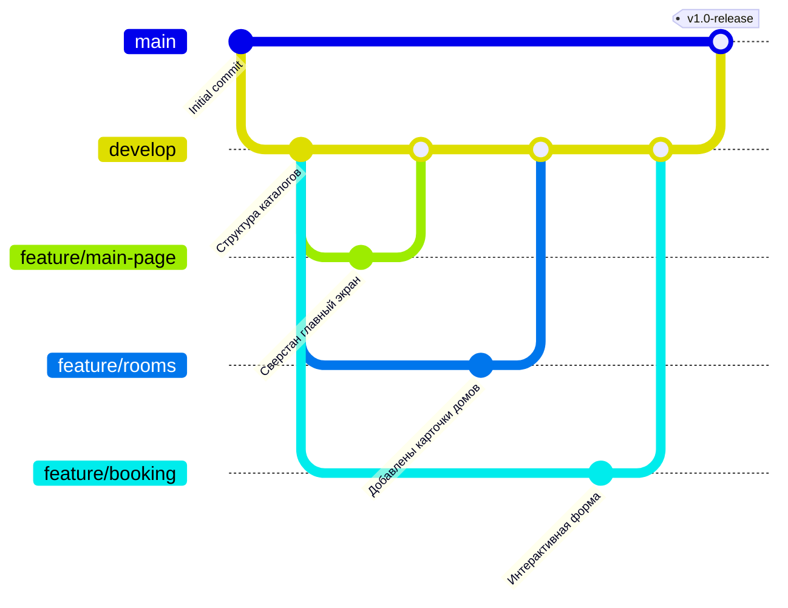

# 🌲 Эко-отель «GreenWood» — Дома на деревьях

Студенческий командный веб-проект статического сайта для эко-отеля, созданный в рамках практической работы по Git.

## 🔗 Ссылки на проект
* **Репозиторий:** [Вставьте ссылку на ваш GitHub репозиторий]
* **Сайт (GitHub Pages):** [Вставьте ссылку на ваш GitHub Pages]

## 👥 Распределение ролей в команде
* **Тимлид (Лидер):** [Имя Фамилия] — Архитектура, Главная страница (`index.html`), базовые стили.
* **Программист 1:** [Имя Фамилия] — Страница номеров и домиков (`rooms.html`).
* **Программист 2:** [Имя Фамилия] — Галерея отеля и локаций (`gallery.html`) + страница `404.html`.
* **Программист 3:** [Имя Фамилия] — Страница бронирования с формой (`booking.html`) + JS-скрипты.

## 🗺️ Схема Git-ветвления проекта

