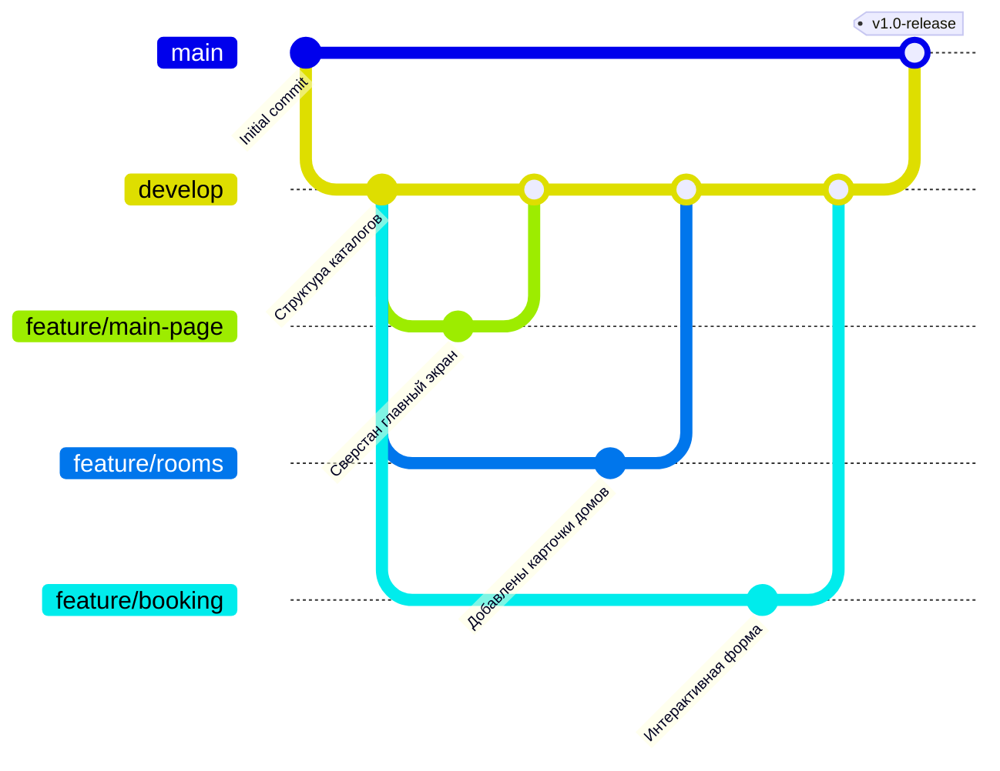

# 🌲 Эко-отель «GreenWood» — Дома на деревьях

Студенческий командный веб-проект статического сайта для эко-отеля, созданный в рамках практической работы по Git.

## 🔗 Ссылки на проект
* **Репозиторий:** [Вставьте ссылку на ваш GitHub репозиторий]
* **Сайт (GitHub Pages):** [Вставьте ссылку на ваш GitHub Pages]

## 👥 Распределение ролей в команде

* **Тимлид (Лидер):** козлов Вячик (Гном нашего времени) — Архитектура, базовые стили, Галерея отеля и локаций (`gallery.html`) + страница `404.html` + Страница бронирования с формой (`booking.html`) .
* **Программист 1:** Иванов Никита (Сидун) — Главная страница (`index.html`) + Картинки + страница комнат (`rooms.html`).
* **Программист 2:** Савиче Ярослав (СЛОФЬЯН) — Readme + JS-скрипты.

## 🗺️ Схема Git-ветвления проекта

